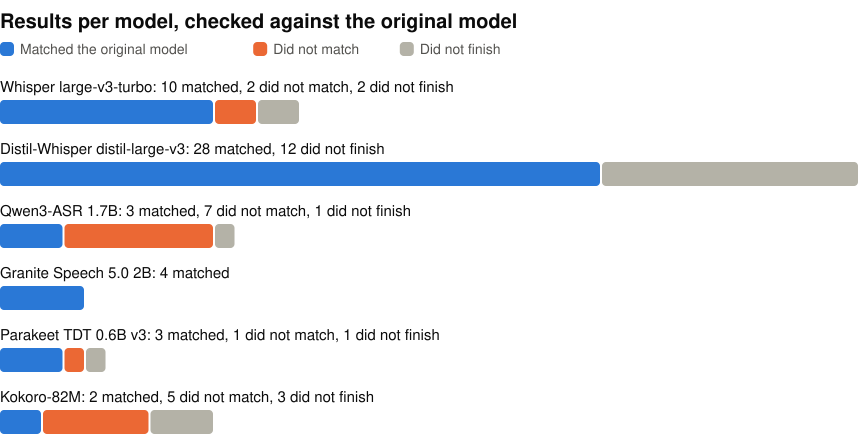

# Audio models on one Windows PC

Speech recognition and text-to-speech models tested on one Windows laptop in November 2026, across runtimes, precisions and devices. Before you build on one of these, you can check whether its output still matched the original model on this machine, how fast it ran, and how much memory it took.

<p align="center">
<picture>
  <source media="(prefers-color-scheme: dark)" srcset="https://raw.githubusercontent.com/john-rocky/windows-audio-zoo/main/docs/images/results-dark.svg">
  
</picture>
</p>

A speech recognition result matches when its word or character error rate in every language is within 0.5 points of the original model in fp32 on the CPU, and no transcript is empty. A text-to-speech result matches when Whisper's transcript of its audio has an error rate within 1.0 point of the original model's. The same model can match on one runtime and not on another, so these counts say nothing about a model as a whole.

- **Speech recognition:** Whisper large-v3-turbo, Distil-Whisper distil-large-v3, Qwen3-ASR 1.7B, Granite Speech 5.0 2B, Parakeet TDT 0.6B v3
- **Text-to-speech:** Kokoro-82M
- **Runtimes:** OpenVINO GenAI 2026.4.1, ONNX Runtime GenAI 0.19.0, ONNX Runtime 1.31.1 with the OpenVINO and WebGPU plugins, LiteRT-LM 0.19.1
- **Processors:** the CPU, Intel GPU and Intel NPU of a Core Ultra 9 386H, and an RTX 5080 Laptop GPU at its 95 W cap
- **PC:** MSI Stealth 16 AI+, 31.5 GB of memory, Windows 11

## Look up a result

Browse [`results/`](results/) by model. The file names give the runtime, precision and device. For example, [`results/whisper/ovg-int8-cpu.json`](results/whisper/ovg-int8-cpu.json) is Whisper on OpenVINO GenAI in int8 on the CPU: English word error rate 4.96 % against 5.13 % for the original model, real-time factor 0.26, first token in 2.9 s, peak memory 3.2 GB. If a run did not finish, its file says why.

To get every result in one table on your own machine, clone the repo and run this. It needs only Python's standard library:

```bash
git clone https://github.com/john-rocky/windows-audio-zoo
cd windows-audio-zoo
python3 tools/table.py
```

It writes `RESULTS_AUDIO_WINDOWS.md` from `results/`.

## More

- [How the results are measured](docs/measuring.md), including the test audio and languages
- [Run everything from an empty folder](docs/reproduce.md), with scripts that drive the PC from a Mac over ssh
- [LiteRT-LM on the Intel GPU and the NPU](docs/litert-lm-intel.md), including why its NPU backend ran on the CPU

## Licences

Each model has its own licence. See [LICENSES.md](LICENSES.md).
